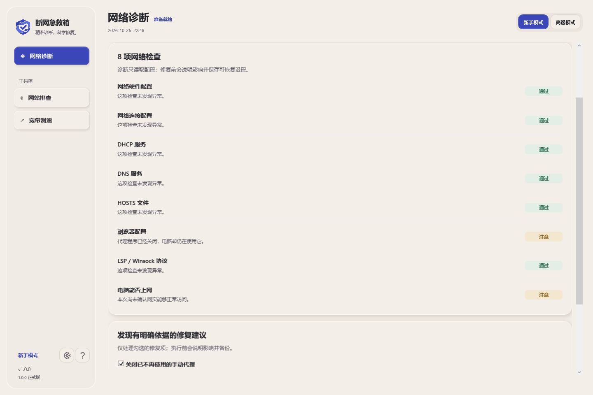
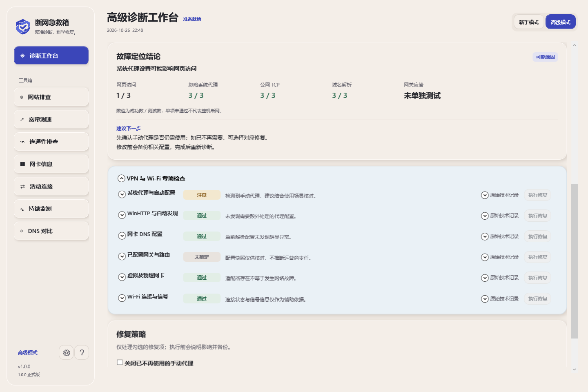
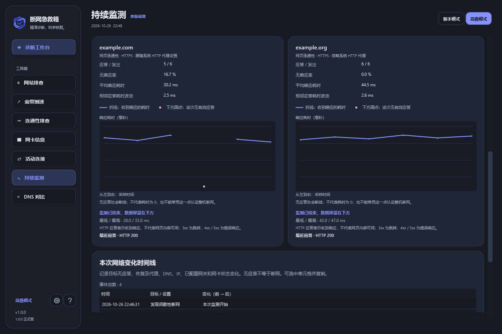
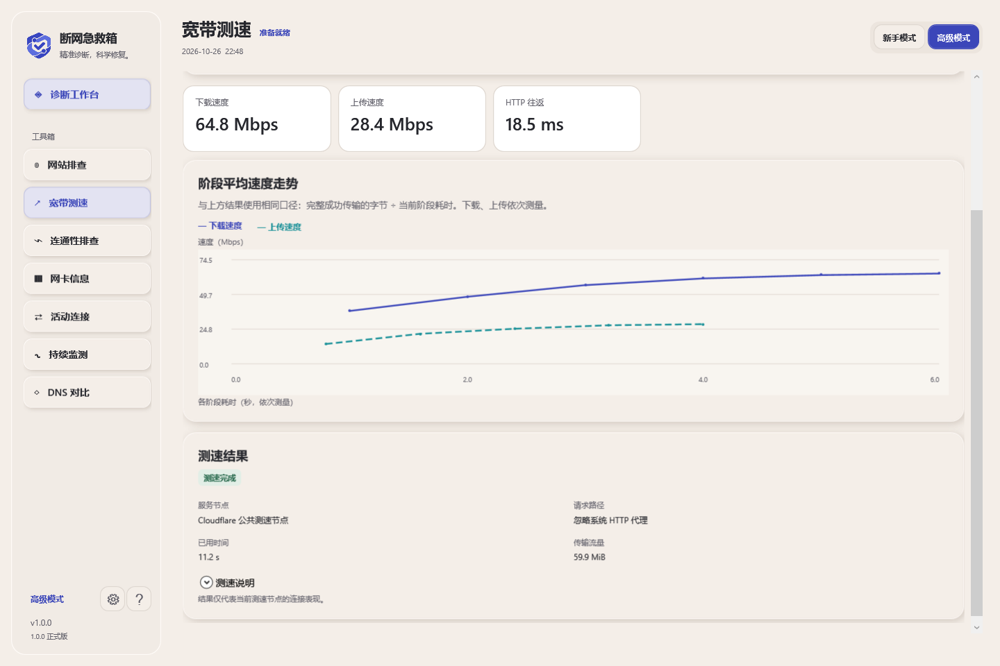
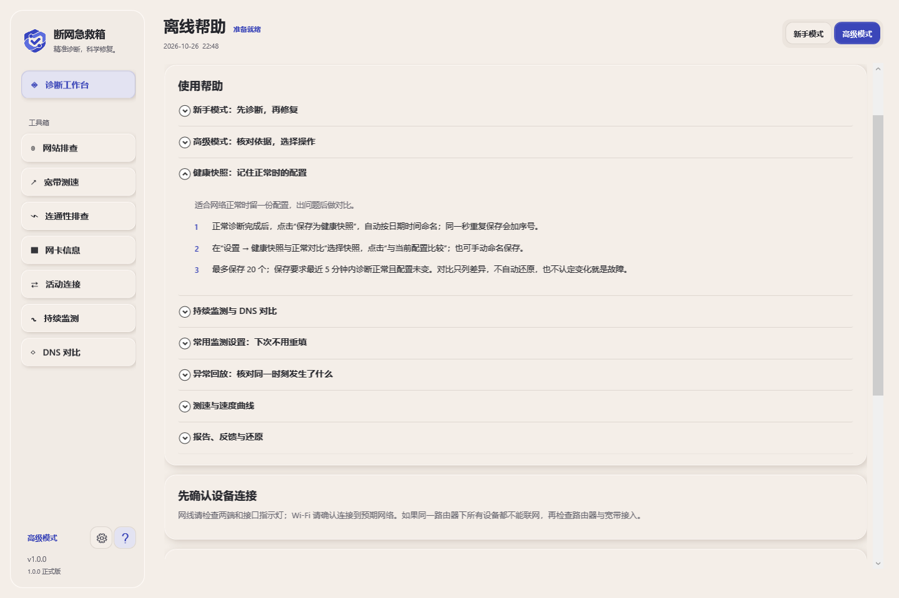

# Network Rescue · 断网急救箱

A local Windows network diagnosis and targeted repair tool. Scan first, inspect the evidence, then choose a repair whose prerequisites are met.

**Developed and maintained by 上官一羽** · **Version 1.3.0** · **GPL-3.0-only**

[简体中文](README.md) · [Download 1.3.0](https://github.com/shangguanyiyu0011/NetworkRescue/releases/tag/v1.3.0) · [Chinese usage guide](docs/USAGE.zh-CN.txt) · [Contributing](CONTRIBUTING.md) · [Validation record](docs/RELEASE-READINESS.v1.3.md)

## Download and run

| System | Portable package |
| --- | --- |
| Windows 10/11 x64 | [NetworkRescue-v1.3.0-win-x64.zip](https://github.com/shangguanyiyu0011/NetworkRescue/releases/download/v1.3.0/NetworkRescue-v1.3.0-win-x64.zip) |
| Windows 10 x86 | [NetworkRescue-v1.3.0-win-x86.zip](https://github.com/shangguanyiyu0011/NetworkRescue/releases/download/v1.3.0/NetworkRescue-v1.3.0-win-x86.zip) |

The baseline is Windows 10 22H2 / Windows 11 with system .NET Framework 4.8 or later. Windows 11 has no x86 edition; a pure 32-bit Windows installation has not been tested.

Extract the entire ZIP to a writable local folder and open `NetworkRescue.exe`. Keep the language, logo and documentation files together. No separate WebView2, .NET SDK, Node.js or Python installation is required. The native system WPF interface embeds no browser and installs no background service. The application is not digitally signed.

## Features

- **Two modes, eight checks:** beginner mode provides diagnosis and eligible recommendations; advanced mode provides grouped evidence, tools and manual selection. Checks cover hardware, connection configuration, DHCP service, DNS, HOSTS, system proxy/PAC, LSP/Winsock and HTTP connectivity.
- **Network tools:** Ping, DNS lookup/comparison, traceroute, TCP ports, adapter cards and active TCP snapshots. Associate readable process names/PIDs, search addresses, ports, PIDs or names, and filter by state.
- **VPN/Wi-Fi investigation:** read-only proxy/PAC/WPAD, WinHTTP, DNS, route, virtual-adapter and Wi-Fi evidence, with confidence and next steps. An installed VPN is not itself a fault.
- **Monitoring and replay:** monitor 1–4 hostnames/IPs concurrently, with per-target HTTPS/ICMP and HTTPS proxy choices. After a manual start, encrypted local history saves every 15 seconds and on finish/close. Limits are 20 sessions and 64 MiB total, with up to 3600 actual samples per target and the latest 300 chart points. The timeline retains 500 events with the full count and truncation notice. Loading saved sessions after restarting replays observations without network checks.
- **IPv4/IPv6 HTTP verification:** website diagnostics force each address family separately, retaining the original hostname and default TLS validation. Each family tries at most 2 resolved addresses within 3 seconds total. No AAAA means IPv6 is not applicable; partial unconfirmed results never automatically disable a protocol.
- **Suspected captive portals:** with supporting evidence and user confirmation, manually open the Windows connectivity trigger page in the system browser. It is not a confirmed portal and does not sign in automatically. Run diagnostics again after signing in.
- **Healthy snapshots and saved settings:** up to 20 snapshots and 20 complete monitoring plans. A healthy diagnosis card can save an automatically named snapshot; Settings also offers manual naming. Selecting saved settings fills inputs without starting monitoring.
- **Reports and backups:** review a redacted preview before saving locally; nothing is automatically uploaded. Repairs save a backup and support validated local restoration and before/after comparisons.
- **Speed test:** single-connection download/upload, HTTP round trips and actual sample curves to Cloudflare's endpoint, describing that path rather than guaranteed ISP bandwidth.
- **Latency under load:** records actual latency samples during idle, download and upload phases, with median, p95 and change from idle. Insufficient samples are marked rather than shown as zero. Results describe only the path to the test node and cannot establish that a router caused the delay.
- **Wi-Fi stability timeline:** only during manually started monitoring, reads the current WLAN connection's signal, link rates and UTC time about every 5 seconds. Up to 720 capture snapshots, with at most 8 interfaces each, can be inspected alongside non-response events. It stores no SSID, BSSID or adapter name and changes no WLAN permissions, services or channels.
- **DNS stability:** explicitly select 1 hostname and 1–4 DNS servers for 3–10 rounds (5 by default), with a 60-second overall limit. Response rate, resolution results and timeout rate are separate. Round latency is total A+AAAA query time, not a single-query RTT. Caches affect the hostname-specific results. No automatic DNS changes or recommendations based on a single fastest result.
- **Manual tray monitoring:** disabled by default. After enabling it and manually starting monitoring, close or hide the window to continue the current session in the tray. Exiting stops and saves monitoring. No startup with Windows, service installation or automatic monitoring. Existing sample, history and checkpoint limits remain. Sustained non-response and recovery notices use debouncing and cooldown and can be muted; they describe the target, not a confirmed computer-wide outage.
- **Observed non-response intervals:** per-target counts, first/last observations, last failure, recovery, open intervals and sampling gaps. Durations cover actual failed observations. HTTP 403 is not treated as an outage, and gaps are not faults. Nearby configuration and Wi-Fi are contemporaneous evidence without causal claims. The UI previews up to 200 intervals and 200 gaps with totals and truncation notices.
- **Single-file offline HTML monitoring report:** converts typed data to anonymous aliases before generating the summary, actual curves and timeline, then builds HTML in memory. The preview is a readable summary of that same anonymized data, not the rendered full page. Confirm before choosing a local save location. No JavaScript or external resources; no automatic opening or upload. All stored samples are plotted without downsampling. A file has an 8 MiB limit; exceeding it produces a notice rather than silently dropping points. Inspect the report before sharing.
- **Update checks:** the official `shangguanyiyu0011/NetworkRescue` repository is configured by default. Empty older settings are filled automatically; non-empty custom repositories are retained. Checks and downloads remain user-initiated, without automatic network checks or installation.
- **Ten languages, two themes:** Simplified/Traditional Chinese, English, Japanese, Korean, German, French, Spanish, Portuguese and Russian; Warm Day and Quiet Night themes. Usage and offline troubleshooting help remain readable without Internet access.

## Repair scope

Repairs require current evidence, confirmation, a fresh configuration check and backup, followed by diagnosis.

| Action | Scope and recovery limit |
| --- | --- |
| `FlushDns` | Clears cache without changing DNS servers; old cache entries cannot be restored |
| `RenewDhcp` | Eligible DHCP adapters only; the lease cannot be rolled back precisely |
| `AutoDns` | Replaces an adapter's custom IPv4 DNS, unselected by default; configuration is recoverable from backup |
| `DisableProxy` | Current-user manual proxy switch only; address and PAC retained; configuration is recoverable |

The app does not automatically clear HOSTS, reset Winsock/WinHTTP, delete routes, remove adapters or restart Windows. A stale local-proxy recommendation requires failed loopback ports, no PAC/WPAD, failure through the manual proxy and a successful direct HTTP request, among other prerequisites. Working proxies, corporate configuration and custom DNS require their intended use to be respected.

Diagnosis and speed tests run with ordinary privileges. Repairs other than disabling the current-user manual proxy request same-account UAC as needed, then require a new diagnosis and selection. A different administrator SID is rejected. An operation completing, configuration changing and connectivity returning are separate findings.

## Monitoring and local data

ICMP does not follow HTTP proxies; a silent gateway is not proof of an outage. Ignoring the system HTTP proxy does not bypass a VPN tunnel. HTTPS reads response headers only, preserves TLS validation, has a three-second cancellation deadline and 32 KiB header limit, and sends no default/proxy credentials or redirect requests. Every HTTP status is a response, not proof of page usability; 407 identifies proxy authentication.

Saving a healthy snapshot requires a successful network diagnosis within five minutes, an unchanged configuration and complete reads at save time. Compare sanitized proxy authorities, DNS/IP, configured gateways and adapter status only. A change is not a fault, and comparison does not restore configuration automatically. Private PAC paths/credentials are not persisted or compared across restarts.

Settings, backups, history and workspace data remain under `%LOCALAPPDATA%\NetworkRescue\`, compatible with earlier versions. Current-user DPAPI protects snapshots/plans; encryption is not anonymization, so review redacted reports before sharing. Monitoring records are automatically encrypted with current-user DPAPI under `Monitoring\`, without upload or a resident background service. Saves occur every 15 seconds and when monitoring ends or the app exits. An `Interrupted` session restores the last checkpoint; up to 15 seconds of samples may be missing. Damaged records are neither overwritten nor deleted; Clear removes only readable records. Monitoring history continues to read schemas 1 and 2 without rewriting old files during reading or replay. Missing Wi-Fi observations in old records do not mean there was no wireless connection. Encrypted records can contain IPs/hostnames and are not anonymous. Tray mode is opt-in and disabled by default; it does not start monitoring or launch with Windows automatically. Exiting stops the current session. TCP/process association is a non-atomic snapshot affected by process exits, access limitations and PID reuse. Filters cover at most 512 captured rows, without elevation or terminating processes.

## Screenshots

These five images show the **1.0.0 WPF UI from the initial upload, with synthetic demonstration data**. They are historical screenshots, not retaken for 1.3.0 and not evidence of 1.3.0 live-window validation or public-network diagnosis or speed tests.



<details>
<summary>Advanced diagnosis, monitoring, speed test and help</summary>









</details>

## Build from source

Use the matching [v1.3.0 source tag](https://github.com/shangguanyiyu0011/NetworkRescue/tree/v1.3.0) in a PowerShell session that already permits local scripts:

```powershell
.\build.ps1 -Architecture x64
.\publish.ps1 -Architecture x64 -SkipBuild

.\build.ps1 -Architecture x86
.\publish.ps1 -Architecture x86 -SkipBuild
```

Builds use system C# 5 / .NET Framework 4.8 and WPF references, with no NuGet restore or runtime download. The default build runs 23 C# suites and writes `build-native-x64` / `build-native-x86`; packages go to `dist`. Calling `publish.ps1 -Architecture x64` or `x86` directly first runs the full build/checks. The scripts do not upload or publish releases.

Product version is 1.3.0 and assembly/file version is 1.3.0.0. This release adds manual tray monitoring and notifications, per-target observed interval summaries and a single-file offline HTML report. All 1.2 features and the scope of the four repairs remain. All 23 suites passed for each final local architecture: 3993 assertions on x64 and 3991 on x86. Report display, offscreen UI, actual NotifyIcon and isolated controller integration coverage and limits are documented in the [1.3 validation record](docs/RELEASE-READINESS.v1.3.md). The [1.2](docs/RELEASE-READINESS.v1.2.md), [1.1](docs/RELEASE-READINESS.v1.1.md) and [1.0 historical records](docs/RELEASE-READINESS.v1.md) retain their own binary bindings and are not 1.3.0 evidence. Official release checksums are defined by the same-commit CI build and SHA256SUMS distributed with the release assets.

## License and feedback

The project's own code is **GPL-3.0-only**; see [LICENSE](LICENSE). Corresponding source and build scripts are provided at the matching [v1.3.0 tag](https://github.com/shangguanyiyu0011/NetworkRescue/tree/v1.3.0). See [third-party notices](THIRD_PARTY_NOTICES.md) for system components and services.

Official use is free; the maintainer sells no activation codes or usage licenses. GPL-compliant paid redistribution is allowed when its license and corresponding-source obligations are met; charging alone is not official impersonation. See the [GNU GPL FAQ](https://www.gnu.org/licenses/gpl-faq.en.html#DoesTheGPLAllowMoney). Report impersonated official sales or paid activation to the relevant platform or `shangguanyiyu0011@gmail.com`. Settings → Feedback only copies the address; the app sends no email or automatic report attachment.

Use [Issues](https://github.com/shangguanyiyu0011/NetworkRescue/issues) for bug reports, removing private configuration, credentials, raw IPs/SSIDs and unreviewed reports first.
